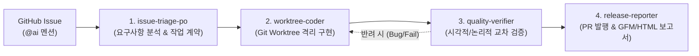

# 🤖 Antigravity Multi-Agent Issue Automation Framework (Harness-v1)

이 문서는 GitHub Issues 기반 자율 개발 및 검증을 전담하는 **`harness-v1` 규격 멀티에이전트 팀의 통합 강령과 협업 프로토콜**을 정의합니다. 본 프레임워크는 어떠한 프로젝트(정적 웹, 풀스택, 백엔드 마이크로서비스 등)에도 복사하여 즉시 활용할 수 있는 범용 이식성(Portability)을 지향합니다.

---

## 1. 멀티에이전트 팀 구성 및 역할 명세

| 에이전트 ID | 페르소나 (Persona) | 핵심 책임 및 역할 | 권한 (`agent.json`) |
|---|---|---|---|
| **`issue-triage-po`** | 요구사항 분석관 & PM | • GitHub Issues `@ai` 멘션 및 본문 요구사항 분석 • 모호한 요구사항 사전 차단 및 `_workspace/spec.md` 작성 • 사용자 피드백 대기 상태(`status:waiting-feedback`) 관리 | `enable_subagent_tools: true` `enable_write_tools: true` |
| **`worktree-coder`** | 격리 구현 엔지니어 | • 메인 트리를 보호하기 위해 `.worktrees/task-issue-#N` 생성 • 명세서(`spec.md`)에 정의된 범위 내 외과적 코드 수정 • 15분 타임아웃 준수 및 1차 단위 문법 검증 | `enable_write_tools: true` (최소 권한 준수) |
| **`quality-verifier`** | 시각/품질 교차 검증관 | • 코더의 작업을 독립적인 제3자 시각에서 교차 검증(Cross-check) • 헤드리스 브라우저를 통한 Before & After 스크린샷 캡처 • **QA Gate 통제**: 물리적 증거(스크린샷) 없이는 절대 승인 불가 | `enable_write_tools: true` `enable_mcp_tools: true` |
| **`release-reporter`** | 배포 및 소통 전담관 | • 원격 브랜치 푸시 및 Pull Request 자동 발행 (`gh pr create`) • 이슈 댓글에 사람 중심(What/How/Why + Before/After 테이블) 보고서 게시 • Worktree 안전 회수 및 진행 추적기(`progress_tracker.md`) 갱신 | `enable_write_tools: true` (최소 권한 준수) |

---

## 2. 핵심 운영 원칙 (Core Directives)

### 원칙 1: 물리적 도구 검증 및 QA Gate 강제 (Zero-Assumption Violation)
* 코드를 수정한 에이전트(`worktree-coder`)가 "작업 완료"를 단언할 수 없습니다.
* 반드시 독립된 `quality-verifier`가 물리적 검증 도구(`scripts/capture_screenshot.py` 또는 테스트 러너)를 실행하여 **실제 디스크 상에 스크린샷/로그 증거 파일이 생성된 것을 확인한 후에만** 릴리스 단계로 승인됩니다.

### 원칙 2: 메인 브랜치 불변 원칙 (Master branch untouched)
* 로컬 `master` 워킹 트리는 어떠한 경우에도 직접 수정되지 않으며, 모든 작업은 반드시 `.worktrees/task-issue-#N` 하위에서 격리 수행됩니다.

### 원칙 3: 산출물 격리 (`_workspace/`)
* 모든 중간 작업 명세서, 분석 로그, 임시 스크린샷은 프로젝트 핵심 소스 트리를 오염시키지 않도록 반드시 `_workspace/` 하위에 보관합니다.

---

## 3. 협업 파이프라인 (Execution SOP)

1. **Phase 1 [Triage]**: `issue-triage-po`가 이슈 번호 #N 수주 → 요구사항 분석 후 `_workspace/spec.md` 생성 및 진척도 갱신.
2. **Phase 2 [Coding]**: `worktree-coder`가 `git worktree add .worktrees/task-issue-#N` 생성 후 코드 외과적 수정.
3. **Phase 3 [Verification]**: `quality-verifier`가 헤드리스 브라우저로 Before/After 스크린샷 캡처 및 정적 검사 수행.
   * 불합격 시 `worktree-coder`로 피드백 반환.
4. **Phase 4 [Release]**: `release-reporter`가 커밋/푸시 → PR 발행(`Closes #N`) → 이슈 댓글에 GFM/HTML 보고서 게시 → Worktree 회수.

---

## 4. 구성 변경 이력 (Change History)

| 변경 일자 | 구성 유형 | 난이도 | 주요 변경 사항 |
|:---:|:---:|:---:|---|
| **2026-11-01** | 신규 구축 및 실증 (Complete) | ⭐⭐⭐ | • `harness-v1` 규격 4대 전문 에이전트 팀 및 전용 스킬 4종 스캐폴딩 완료 • Git Worktree 기반 무간섭 격리 및 Windows 헤드리스 브라우저 스크린샷 엔진 구축 • Before & After 시각적 검증 및 What/How/Why 표준 리포트 체계 확립 • 메인 세션 컨텍스트 보호(토큰 제로 파일 링크 리포팅) 모듈 구현 • 파일럿 이슈 #1(배경 검정→화이트) E2E 실증 검증 완료 및 PR #3 발행 • 타 프로젝트 3분 이식 가이드(`docs/PORTABILITY_GUIDE.md`) 패키징 완료 |
