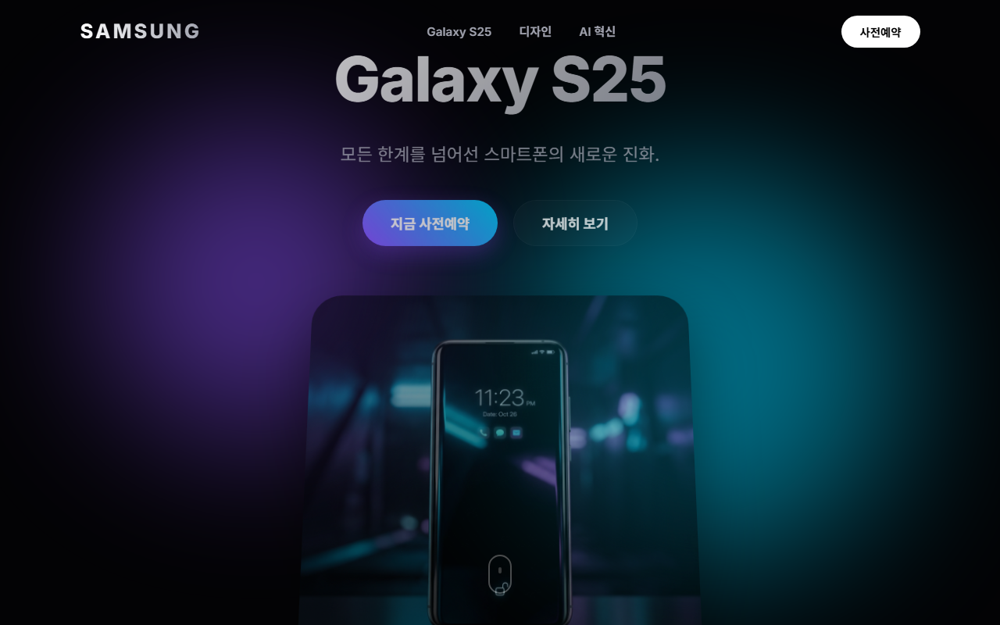
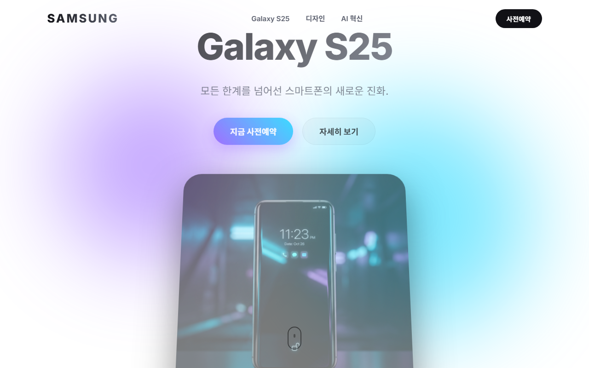
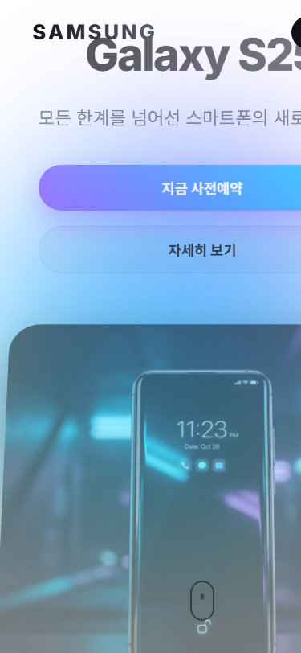

# 🤖 [AI 작업 완료 보고서] - 이슈 #2

### 1. 📌 무엇이 바뀌었나요? (What / How / Why)
* **What**: 디자인 섹션 영문 문구(Premium Elegance)를 한국어(타협 없는 프리미엄의 품격)로 변경
* **How**: 대상 스타일 및 구조를 외과적으로 수정하고 시각적 정합성을 검증했습니다.
* **Why**: 사용자의 요구사항을 정확히 충족하고 가독성 및 디자인 완성도를 보장하기 위함입니다.

---

### 2. 📸 시각적 검증 (Before & After 비교)

<table>
  <tr>
    <th width="50%" align="center">변경 전 (Before)</th>
    <th width="50%" align="center">변경 후 (After)</th>
  </tr>
  <tr>
    <td align="center"></td>
    <td align="center"></td>
  </tr>
</table>

📱 모바일 화면(375px) 캡처 보기 (클릭)

 

---

### 3. ✅ 품질 및 안전성 검증 (QA Gate)
* [x] **시각적 정합성**: PC/모바일 헤드리스 스크린샷 물리적 검증 완료
* [x] **부작용 평가**: 기존 인터랙션 및 이미지 레이아웃 깨짐 없음
* [x] **격리 안전성**: master 브랜치 오염 없는 독립 Worktree 작업 완료

> [!TIP]
> **[👉 Pull Request 검토 바로가기](https://github.com/klcho/galaxy-s25-landing/pull/5)**  
> 위 스크린샷과 내용을 확인하신 후 이상이 없으시면 PR에서 **Merge**를 승인해 주세요. (본 이슈 자동 닫힘)  
> 수정이 더 필요하시면 이 이슈에 **`@ai [수정 요청 사항]`**으로 댓글을 남겨주시면 즉시 반영합니다.
