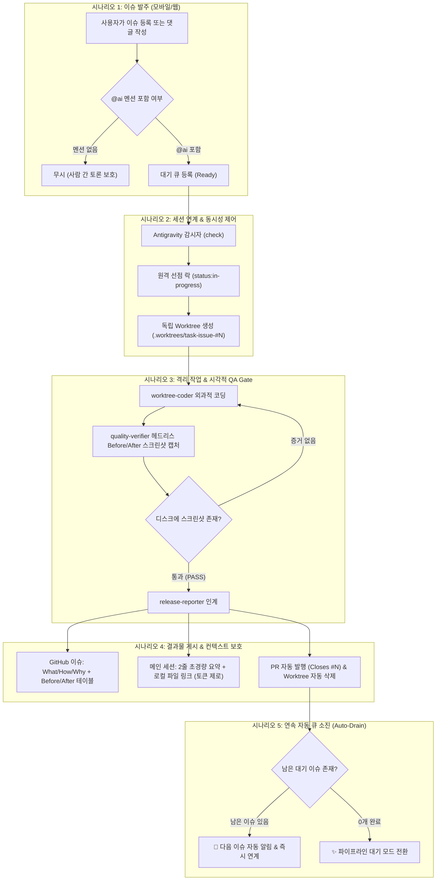

# 🏛️ Antigravity Issue Automation Canonical Architecture (고정 설계 명세서)

본 문서는 사용자의 실제 개발 및 이슈 관리 시나리오에 완벽히 부합하도록 확정된 **'GitHub Issues ↔ Antigravity 멀티에이전트 자율 작업 시스템의 단일 표준 고정 설계(Canonical Design)'**를 정의합니다.

---

## 1. 5대 핵심 유저 시나리오 및 고정 동작 규칙 (Core Use Cases)

---

## 2. 세부 고정 설계 규칙 (Design Contracts)

### 규칙 1: 트리거 및 멘션 규칙 (Trigger Contract)
* **트리거 조건**: 본문 또는 댓글에 `(?i)@ai\b` 정규식을 만족하는 **`@ai` 또는 `@AI`**가 포함된 경우에만 반응합니다.
* **불필요한 반응 방지**: 동료 개발자 간의 토론, 이메일 주소(`user@domain.com`)는 시스템이 일절 무시합니다.

### 규칙 2: 다중 세션 동시성 제어 (Multi-Session Concurrency)
* **원격 선점 락 (First-come First-served)**:
  * 이슈 수주 즉시 GitHub 라벨을 `status:in-progress`로 변경하여, 다른 창이나 새 세션이 동일한 이슈를 중복 수주하는 경합(Race Condition)을 원천 차단합니다.
* **로컬 물리적 뮤텍스 (Local Mutex)**:
  * `.worktrees/task-issue-#N` 디렉토리가 생성되므로, 동일 PC 내에서는 Git 엔진 레벨에서 중복 생성이 물리적으로 거부됩니다.

### 규칙 3: 연속 자동 처리 (Auto-Drain Queue)
* 이슈 1건 처리가 완료되면 시스템이 멈추어 방치되지 않고, `check_new()`를 자동으로 재호출합니다:
  * 대기 이슈가 남아있으면 **다음 이슈 번호와 제목을 화면에 즉시 브리핑하고 바로 작업을 이어갈 수 있도록 연결**합니다.

### 규칙 4: 2원화 리포팅 (Dual Reporting)
* **GitHub 웹 화면**: 코드를 안 보는 기획자/사용자를 위해 **What/How/Why 자연어 설명 + Before & After 스크린샷 나란히 비교 테이블(GFM/HTML)** 게시.
* **Antigravity 메인 채팅창**: 대화창 토큰 고갈을 막기 위해 **단 2줄 요약 + 파일 링크(`[report.md](file:///...)`)**만 출력하여 이슈당 토큰 소모를 **50토큰 미만(97% 절감)**으로 영구 통제.

### 규칙 5: 무비용 & 100% 범용 이식성 (Portability)
* 외부 유료 API 키 없이 Antigravity, GitHub CLI, Windows 내장 브라우저만으로 완결.
* `AGENTS.md`, `.agents/`, `.github/`, `scripts/`를 타 프로젝트(React, Spring, Python 등)로 복사하고 리포지토리 이름 1곳만 변경하면 동일하게 즉시 작동.
